# Curb Cut architecture

```mermaid
flowchart LR
    scout["Scout or user report"] --> task["Barrier task"]
    task --> deterministic["Matching templates and recipes"]
    deterministic --> patch["Declarative JSON patch"]
    deterministic -->|"No passing candidate"| agent["Repair agent (Codex or Grok)"]
    agent --> patch
    patch --> local["Local oracle<br/>Persona and pointer control"]
    local --> kane["Kane recordings<br/>Before, control, after"]
    kane --> bundle["Extension bundle"]
    local -->|"Measured coverage or family sample bypass"| bundle
    bundle --> recheck["Nightly local recheck<br/>Retire or mark broken"]
    recheck -->|"Update feed"| bundle
    bundle --> owner["Site-owner Markdown report"]
    keys["Opt-in keyboard help<br/>Navigation keys and anonymous focus"] --> detect["TypeSafe Jev<br/>Stuck yes/no"]
    detect -->|Above threshold| offer["Ask whether to fix this page"]
    offer -->|User accepts| names
    visible["Opt-in live naming<br/>Visible unnamed controls"] --> names["TypeSafe Jev<br/>Cropped icons and fixed label choices"]
    names -->|Above threshold| temporary["Names in this tab<br/>Unverified"]
    text["Visible prose"] --> language["TypeSafe Jev<br/>Language choice"]
    language --> langproof["Local setLang replay"]
    hotkey["Opt-in Alt+Shift+F"] --> jev["TypeSafe Jev<br/>Visible-tab screenshot and candidate state"]
    jev --> temp["Temporary patch<br/>Current tab, Escape to undo"]
    temp --> queue["Local verification queue"]
    queue -->|"verify-queue"| task
```

The repair agent is selected with `CURBCUT_AGENT` (`codex`, the default, or `grok`). `check` derives a task from a URL and plain English, then runs the local oracle and the `fix` loop. `gate` replays configured tasks against a developer’s running app and prints failures for a coding agent to fix in source. Tasks with a declarative objective try inherited templates and deterministic recipes before requesting an agent proposal. The agent tries a small or fast model first and retries once with a larger model when selector validation or the local before/after check fails (`CURBCUT_LADDER=off` disables this). Passing local repairs proceed to Kane verification or publish with local evidence under the family sampling policy. `curbcut family` applies one inherited template across sites that share a platform or theme and writes one owner report. Tasks without a local objective use the Kane baseline to collect the failure. [Live loop](core/loop.mjs) · [Cost policy and replay](proof/cost/README.md)

The pull request action waits for a preview URL, runs the gate, uploads Kane recordings, and posts one sticky comment. [PR bot](docs/pr-bot.md)

The live naming path gathers crops from the active viewport and combines them with a fixed vocabulary and page-specific candidates. It verifies the tab, document and target before attaching a temporary name. The keyboard-help check sends a bounded allowlist of navigation keys, anonymous focus IDs, roles, visibility, timing and interaction effects. It offers a known rule or a one-time naming pass after a confident result. [Decision evidence](proof/jev/README.md)

## Patch DSL

A patch carries a site and URL match, persona, task, barrier, rules, status and evidence. Rules name CSS selectors and a supported action with typed arguments. [Schema](schemas/patch.json) · [Engine](core/engine.js)

| Purpose | Actions |
| --- | --- |
| Accessible names and semantics | `addLabel`, `setRole`, `setAltText`, `setLang` |
| Focus and activation | `makeFocusable`, `bindEnterToClick`, `restoreFocusOutline`, `removeFocusTrap` |
| Keyboard widgets and hover | `mirrorHoverToFocus`, `mirrorHoverEventToFocus`, `toggleOnActivate`, `arrowKeyNavigation`, `dialogBehavior`, `listboxBehavior` |
| Presentation and timing | `injectCSS`, `setContrast`, `extendTimeout` |

## Personas

Keyboard-only uses trusted keyboard input and blocks pointer input. Low vision checks reflow in a 320 CSS pixel viewport. Reading view exposes DOM roles, accessible names and control state in a navigable dialog. Color-blind mode simulates deuteranopia. The v6 contrast and language lanes measure rendered contrast and language attributes separately. Pointer control checks that the same objective is possible with ordinary sighted input when the protocol uses that lane. [Browser harness](core/browser.js) · [Proof protocol](proof/methodology/README.md)

## Why declarative

The extension and replay browser share one engine. The schema bounds actions and CSS values, and the engine applies rules only on their matching URLs. Rules can be inspected, replayed against the same task and removed to restore the original page. The bundle carries JSON data and ships its executable code with the extension. [Extension build](scripts/build-runtime.mjs) · [Bundled rules](extension/bundled.json)

## Proof protocol

The optional visual preflight classifies a fresh, isolated start screenshot before case selection. Confident bot challenges stop Kane verification in interactive repairs and gates. The registered Kane runner uses the original study protocol. [Preflight backtest](proof/jev/preflight-backtest.json)

Freeze the workflow, pin the sampling source and seed, and commit the site draw before scouting and the eligible tasks before repair. Record blocked, unresolved and inconclusive outcomes against the registered denominators. Seeded Kane selections record which locally repaired tasks are eligible, along with run limits. Evidence ledgers link the original browser results, recordings, sealed Kane packs and session IDs. The integrity scripts reconstruct frozen Git trees and verify recorded input hashes. The v6 verifier also checks shipped patch bytes. [V4 integrity](proof/hard-v4/verify-integrity.mjs) · [V5 integrity](scripts/verify-v5.mjs) · [V6 integrity](scripts/verify-v6.mjs) · [V7 integrity](scripts/verify-v7.mjs)

The nightly local recheck retires a verified rule when the original task passes and marks a rule broken when the patched task fails. Inconclusive checks retain its prior status. The separate Kane recheck can invoke the repair loop. The popup and CLI export the WCAG criterion, applicable rule and linked evidence. [Recheck code](core/recheck-local.mjs) · [Example cron](examples/curbcut.cron) · [Example report](evidence/v4-86f207deeb57-7bc09a21/report.md)

## Repo map

| Path | Contents |
| --- | --- |
| [`core/`](core/) and [`schemas/`](schemas/) | Repair engine, browser harness, agent and Kane loop, server, JSON contracts |
| [`extension/`](extension/) | Manifest, popup, settings, content scripts, bundled rules |
| [`tasks/`](tasks/) and [`patches/`](patches/) | Task inputs and patch catalog |
| [`proof/`](proof/) and [`evidence/`](evidence/) | Study inputs, results, recordings, Kane packs and site-owner reports |
| [`scripts/`](scripts/) and [`tests/`](tests/) | Study runners, release builds, verification and tests |
| [`fixtures/`](fixtures/) and [`examples/`](examples/) | Local test pages, example nightly schedule, and pull request workflow |
| [`site/`](site/) and [`launch/`](launch/) | Evidence dashboard, film, screenshots and launch copy |
| [`docs/`](docs/) and [`.github/`](.github/) | Original build brief, agent gate, pull request bot, and Pages workflow |
| [`curbcut.mjs`](curbcut.mjs) | CLI entry point: `fix`, `check`, `gate`, `family`, `cost`, `report`, `recheck` |
