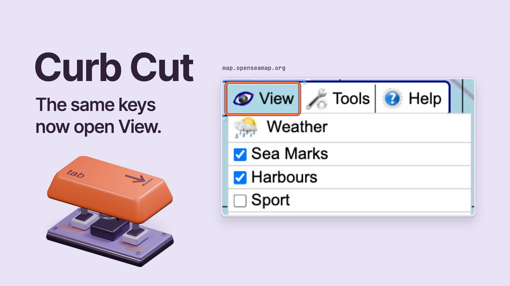

# Curb Cut

A Chrome extension that fixes accessibility barriers on public websites, with proof for each shipped repair.

[](launch/curbcut-launch.mp4)

Watch on YouTube: (link coming)

## The problem

A menu that opens only on hover can shut out keyboard users. An unnamed search field can leave screen reader users guessing. WebAIM detected WCAG failures on 95.9% of the million home pages it tested in 2026, and six failure types accounted for 96% of detected errors. [WebAIM Million 2026](https://webaim.org/projects/million/)

| Failure type | Home pages affected | Curb Cut repair | Locally fixed | Kane verified |
| --- | ---: | --- | ---: | ---: |
| Low contrast text | 83.9% | Adjust foreground or background | 47/62 v6 | Local proof |
| Missing image alternatives | 53.1% | Add grounded alternative text | 8/12 v6 | 3/5 sampled |
| Missing form labels | 51% | Name the input | 19/20 v5 | 6/6 sampled |
| Empty links | 46.3% | Name the link by its purpose | 12/12 v6 | 1/5 sampled |
| Empty buttons | 30.6% | Name the control by its function | 9/12 v6 | 3/5 sampled |
| Missing document language | 13.5% | Set the language when detection agrees | 1/1 v7, 0/20 v6, 3/3 development | Local proof |

[Cohort evidence and recordings](proof/README.md)

## How it works

1. Scout a public page and record a reproducible barrier task.
2. Give Codex the failed task and browser observations. It proposes a scoped, reversible JSON patch.
3. Replay the task with the accessibility persona and a pointer control. Kane records eligible before, control and after runs. Contrast and language use local browser measurements.
4. Ship repairs with evidence. Recheck them as sites change and export a Markdown report that the site owner can use to fix the source.

[Architecture and patch format](ARCHITECTURE.md)

## Results

| Check | Result | Evidence |
| --- | --- | --- |
| Held-out v6 | **76/118** local repairs across **400** scouted sites | [V6 results](proof/README.md#held-out-v6) |
| Held-out v5 | **99/142** local repairs across **2,050** scouted sites, including **51/89** multi-step journeys | [V5 results](proof/README.md#held-out-v5) |
| Kane samples | **11/20** in the v5 random sample and **7/15** in the v6 naming sample | [V5 sample](proof/heldout-v5/README.md#seeded-kane-sample) · [V6 sample](proof/heldout-v6/README.md#kane-results) |
| Earlier Kane cohorts | V4 **2/21** selected, v3 **10/23**, v2 **13/39**, original **0/26** | [Earlier studies](proof/README.md#v4-and-earlier) |
| Live fixes | **105** bundled fixes, **61 Kane-verified** and **44 with local proof** | [Installed-extension audits](proof/README.md#installed-extension-and-reliability) |

## Try it

Use the extension zip from GitHub Releases once published, or open `chrome://extensions`, enable **Developer mode**, select **Load unpacked**, and choose [`extension/`](extension/). Try the About menu on [Massachusetts higher education](https://www.mass.edu/) with the fix off and on. Tab to **About**, open the submenu, and follow **The DHE**. [Before](proof/hard-v4/kane/v4-86f207deeb57-7bc09a21/before/recording.mp4) · [After](proof/hard-v4/kane/v4-86f207deeb57-7bc09a21/attempt-1/after/recording.mp4)

## Check our numbers

With Node 22 or later, run these from the repository root.

```sh
npm ci
npm test
npm run build
node scripts/verify-v6.mjs
node scripts/verify-v5.mjs
node proof/hard-v4/verify-integrity.mjs
```

With Playwright Chromium installed, `node scripts/extension-e2e.mjs` rechecks the bundle on live public pages. Pass patch IDs to replay a subset. [Proof index](proof/README.md) · [Replay instructions](proof/methodology/README.md)

## Limits

Each result covers a recorded task. Reading view models DOM roles and names, and screen reader parity remains untested. Kane can hit its step limit or return an inconclusive result.

Opt-in TypeSafe Jev live naming confirmed **6/10** accepted names on v7, with **10/14** coverage and **666 ms** median viewport latency. Kane verified **2/5** sampled naming cases. The language decision fixed **1/1** v7 task in the local oracle. [Jev decision evidence](proof/heldout-v7/README.md)
