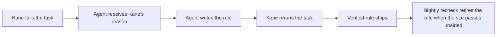

# Curb Cut

Curb Cut uses Kane to reproduce accessibility barriers, verify repairs, and ship browser fixes with replayable evidence.

[Watch the launch cut](launch/curbcut-launch.mp4) · [Full demo](launch/curbcut-demo.mp4)

## Install in Chrome

1. Download and unzip the [extension package](site/assets/curbcut-extension.zip). To build it yourself, run `npm ci` and `npm run package`.
2. Open `chrome://extensions` and turn on **Developer mode**.
3. Select **Load unpacked** and choose the extracted folder.

## Try it in 60 seconds

Use a shallow clone for a quick checkout. The full history carries evidence recordings.

```sh
git clone --depth 1 https://github.com/VasuBansal7576/curbcut.git
```

Open [Mass.edu](https://www.mass.edu/), Tab to **About**, press **Arrow Down**, and use **Tab** to reach **The DHE**. Open Curb Cut’s popup to see the applied menu fix, toggle it off to compare, and open the evidence for the recorded runs. [Before, pointer control, and after](proof/README.md)



## For developers

Use Node.js 22 or newer. Run `npm ci` and `npm link` to install the CLI, or run `node curbcut.mjs` directly. Run `npx playwright install chromium` before running local browser checks or the test suite.

- `curbcut check <url> "<task>"` runs the repair loop for a plain-English task. Run with `--dry-run` first to see the estimated Kane credit cost. Live runs require an authenticated Kane CLI and the selected coding agent CLI on your PATH. Set `CURBCUT_AGENT=grok` or `CURBCUT_AGENT=codex` (default) to select the repair agent.
- `curbcut verify-queue [report-id]` checks saved barrier reports and instant repair candidates. Run `curbcut serve` to receive reports from the extension. Describe the control and the visible result in the report so Curb Cut can derive a replayable task.
- `curbcut gate --config curbcut.gate.json` prints failing selectors and reasons so a coding agent can fix the source. Add `--local` to Check or Gate for Playwright without Kane credits. The [Claude Code Stop hook](docs/gate.md#claude-code-stop-hook) runs Gate after edits.
- The [PR bot](docs/pr-bot.md) runs Gate against a preview URL, posts one updated comment, and uploads Kane recordings.
- `curbcut cost` summarizes recorded tokens and Kane balance changes. Recipes and inherited rules get a local replay before a full agent proposal. The family policy samples eligible inherited fixes for Kane. The repair agent tries a small model first and retries once with a larger model unless `CURBCUT_LADDER=off`. [Cost proof and policy](proof/cost/README.md)
- `curbcut family <listfile-or-urls...> --template <family-id>` applies one inherited template across public sites that share a platform or theme and writes one upstream report for the platform author. Add `--kane` to verify at most two repaired sites under the family sampling policy. [Family scan](proof/family/README.md)
- `curbcut census <url-list-file> --limit N` estimates recipe-pattern reach from public pages. The limit caps the input sample. The command also visits separate calibration pages. [Census](proof/census/README.md)

Run `node curbcut.mjs serve` in a separate terminal for the shop fixture.

```sh
CURBCUT_AGENT=grok node curbcut.mjs check http://127.0.0.1:4317/fixtures/shop/ "Search for headphones and add Field Headphones to the cart. Confirm Cart (1)."
```

## Browser extension

The popup shows applied repairs, provenance, and retired fixes. Report a barrier from the popup or via the configurable shortcut, then share the source-change report with the site owner. Reading view, low-vision tools, opt-in Jev naming, visual state sync, Glance, and Find a service, plus experimental Match mouse can help on pages without a bundled fix. [Evidence dashboard](site/index.html) · [Match mouse](proof/mirror-dom/README.md)

## Four uses of Kane

1. Reproduce the barrier and capture a failure reason for the repair agent.
2. Establish a working pointer control for the same task.
3. Replay the repaired task and save the verdict, recording, and sealed evidence pack.
4. Recheck the native site to retire a repair when the site passes unaided. The nightly schedule also supports a Playwright lane.

## Measured results

- **105 bundled fixes**, with **61 Kane-verified** and **44 with local proof**. The latest installed-extension audit recorded **98/105 primary passes**, with seven unconfirmed. [Catalog](extension/bundled.json) · [Live audit](proof/reliability/submission-extension-e2e.json)
- V7 confirmed 6/10 accepted names and 1/1 language fix locally. Kane verified 2/5 live-naming cases. V6 fixed 76/118 locally and Kane verified 7/15 sampled names. V5 fixed 99/142 locally, including 51/89 journeys. Its Kane samples verified 11/20, 0/4, and 1/2 in the 50-step rerun. Hard v4 fixed 64/102 locally and Kane verified 2/21. Kane verified 10/23 in v3, 13/39 started in v2, and 0/26 in the original holdout. [Study details](proof/README.md)
- Cost replay reproduced 99/142 v5 fixes at 19,905 versus 31,949 estimated tokens per fix and 76/118 v6 fixes, including 47 recipes. Both cohorts had zero confirmed inheritance or diff hits. Live recipes fixed 18/89 journeys. Live inheritance had 0 hits, 11 near misses, and 0 false matches across 34 tasks. Grok 4.5 corrected 0/11 near misses at about 155 estimated tokens per task. The bounded Grok 4.6 retry corrected 9/11 at about 3,554 estimated tokens per task versus 11,678 for the archived full-agent path. Two were unconfirmed after oracle timeouts. [Cost studies](proof/cost/README.md)
- Match mouse found 1/22 held-out matches, with zero wrong matches or pointer regressions in the one repair. Kane verified 0/1. The development replay also found 1/22. [DOM parity](proof/mirror-dom/README.md)
- The Jev mirror backtest missed its pre-set bar of 95% precision at 50% recall in development. On 95 test pairs it reached 75.0% precision, 40.5% recall, and 0.753 AUROC. The original instant repair study fixed 2/102 development and 3/142 held-out tasks, with zero Kane follow-ups after three cases qualified against a minimum of five. [Mirror backtest](proof/jev/mirror-backtest/README.md) · [Jev studies](proof/jev/README.md)
- Live Jev naming applied 15/35 names across 19 public sites. Manual review found 13 correct and two vague, with names applied on 7/13 sites that exposed unnamed controls. Median time to the first name was 1.14 seconds. The archive predictor scored 427 sessions and the frame auditor flagged 37/49 packs. [Live naming review](proof/jev/live-naming-real-sites.json) · [Archive studies](proof/jev/README.md)
- Find a service scored 24 civic queries. Eleven matched literally, Jev found six more, and seven abstained. The study scored zero unrelated destinations using term overlap. Glance’s yes/no questions scored 14/16 for dialogs, 15/16 for cookie banners, and 15/16 for errors. Its measured main-content and primary-action boxes scored 2/16 and 0/16 and were dropped. Glance jumps using the page’s DOM main region. Experimental visual state sync made 3 changes deemed correct by the page-state heuristic, 0 wrong, and 677 abstentions. Median decision times were 293 ms for Finder’s Jev calls, 441 ms for Glance, and 1,070 ms for state sync. [Protocol and results](proof/jev/state-glance-finder/README.md)
- Census observed 103/200 pages, with 77 blocked and 20 failed. Jev’s observed shares included hover-only menus at 67.0%, unnamed fields and reflow overflow at 51.5% each, and low contrast at 29.1%. These are reach upper bounds based on apparent pattern presence. The 100 calibration labels were positives only, so the study reports recall. [All twelve recipe shares](proof/census/README.md)
- Archived demo Kane sessions recorded Check fail, pointer pass, and after pass (`f0760ff2-f04f-4de2-88b8-915b609b7e02`, `8987d2d8-c2c7-47b0-955a-1617d9c5327b`, `d942c3ca-79a9-4d2e-8c3b-0c7a18f5265b`), Gate fail and pass (`2f63df68-fe0f-47b5-8f34-918444b55049`, `2d512cc4-756e-4a96-bcfb-bec5ea33773a`), and retirement (`0c6e7186-06cc-4a75-8744-dbf3c5be066b`). [Demo ledger and footage](proof/demo/README.md)

[Architecture](ARCHITECTURE.md) · [Proof index](proof/README.md)

[LICENSE](LICENSE) (MIT)
