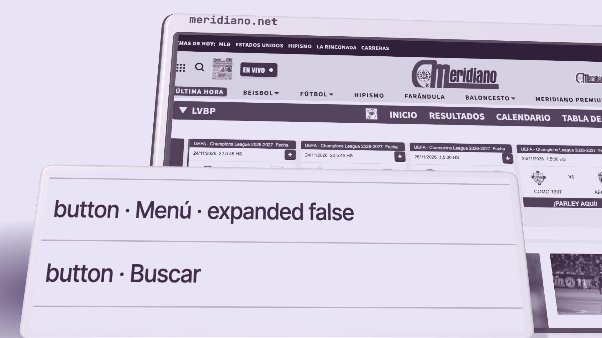

# Curb Cut opening

[Play the ten-second film](opening-10s.mp4) · [English captions](opening.en.vtt) · [Four matched moments against Ace of Frames](comparison.jpg)

The same Tab press reaches the same About link on Mass.edu twice. The first time, the photograph underneath stays visible. The second time, the menu covers it. The installed extension’s Apply fixes switch is the only change between those two runs.

## Look and timing

[Colour and type](palette-type.png) · [Benchmark study](benchmark.md) · [Eight-film contact sheet](benchmark-contact.jpg) · [Shot marks and measurements](measurements.json)

| Film time | Picture | Edit or movement anchor |
|---|---|---|
| 0.00–0.93 | The landing page’s physical key beside the live site recording. The cap travels down and the spring compresses. | Press at frame 12 on “Tab” at 0.393 s. |
| 0.93–3.00 | Push toward the closed About menu. Leave the photograph beneath the trigger in view. | Cut at frame 28 on “The” at 0.943 s. |
| 3.00–5.17 | Lift the captured popup. Hold OFF, then show ON with the switch in Signal orange. | Cut on the 3.00 s music beat. State changes at frame 117 on “Cut” at 3.900 s. |
| 5.17–6.17 | Repeat the key shot. About opens under the same press. | Frame 155 on “Same” at 5.188 s. Second press at frame 165 on “keys” at 5.488 s. |
| 6.17–8.50 | Return to the matching close-up. The DHE through Contact Us are visible. | Frame 185 on “Now” at 6.163 s. |
| 8.50–10.00 | Pull back to the key alongside the open site. | Cut at frame 255 on the half-second music grid. |

Reference stills for the opening and the later Jev sequence follow. The Jev still pairs Meridiano’s captured masthead with the two Spanish button names from its recorded Reading view.

| Tab press | Extension on |
|---|---|
| [](stills/01-tab.png) | [](stills/02-switch.png) |
| **Mass.edu menu** | **Jev on Meridiano** |
| [](stills/03-menu.png) | [](stills/04-jev.png) |

## Picture and sound sources

The Mass.edu inputs are [the closed run](source/closed.mp4) and [the repaired run](source/repaired.mp4). A temporary Chromium profile loaded the repository extension and the public site. Both captures start with the preceding link focused, then receive a real Tab event. [The capture log](source/capture.json) records the focus target, menu visibility and key-event time. The compositor places the captured motion on the screen surface at its recorded pace. The adjacent physical key is an illustration of the input.

The popup uses [the installed OFF state](source/switch-off.png) and [the installed ON state](source/switch-on.png), captured at 4× device scale on the Mass.edu tab. The colour treatment preserves the control position, checked state and wording. The cap, spring and foot are the landing page’s original transparent image layers, copied byte-for-byte into [the film source](source/tab). Inter Tight carries display and body copy. JetBrains Mono identifies the source site. The on-site text retains the lettering captured from each page.

The Jev still uses the [Meridiano capture](../../film/a2/plates/meridiano.jpg), the [named controls](../../film/plates/jev-on.png) and the [live naming record](../../../proof/jev/live-naming-demo/capture.json).

The three spoken sentences come directly from the original stereo mix in Git at e340b07, launch/audio/master.m4a. The first 8.04 seconds supply the narration, key sounds and score. A 40 ms crossfade joins them to the instrumental tail at 73.50 seconds so the checkpoint ends on a complete thought. The score is the repository’s locally synthesized 120 BPM bed, composed from oscillators and a pulse in launch/scripts/score.py at that commit. The voice is the original af_heart recording at speed 1.04. The resulting mix receives 0.6 dB of gain.

## Verification

The checkpoint runs 10.000 seconds, with 300 H.264 frames at 1920 × 1080 and 30 fps. It carries stereo 48 kHz AAC and selectable English captions. FFmpeg measured −16.34 LUFS integrated and −1.00 dBTP on the encoded soundtrack. The captions extracted from the MP4 match the five WebVTT cues. I checked the picture at every half second and checked the four full-resolution stills against their source captures.

## Rebuild the checkpoint

With the repository’s locked Node dependencies, Playwright Chromium and FFmpeg installed, run from the repository root.

```sh
node launch/direction/v8/source/render.cjs
```

The renderer stages the HyperFrames composition and Three.js 0.180.0 in a temporary directory. It seeks the paused timeline at each of the 300 output frames in headless Playwright Chromium. The original audio comes from local Git history. The renderer reads the committed captures for repeatable results. To capture the public site and installed switch again, run [the capture script](source/capture.cjs).
