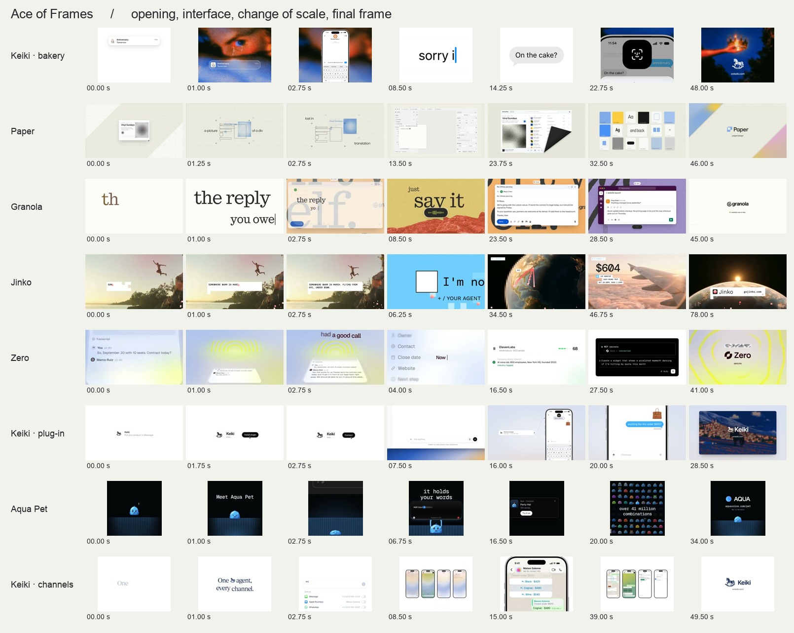

# What the first three seconds buy

Eight Ace of Frames films, 1,505 picture samples at 4 fps. Each row in the contact sheet follows one film. The first three columns stay inside its opening three seconds. Later columns isolate a change in scale, an interaction and the ending.

## Rhythm and colour

A shot starts when the edit establishes a new view, including a continuous move into a distinct new framing. An in-place update such as a typing cursor stays in its shot. I marked the first sampled frame of each new view. Boundaries have a quarter-second sampling interval. The average divides the video-track duration by the shot count. The shortest includes the final hold. All marks and source file hashes are in [the measurement ledger](measurements.json).

| Film / exact source | Seconds | Shots | Mean / shortest, s | Measured colour families, largest first |
|---|---:|---:|---:|---|
| [Keiki · bakery](https://aceoframes.com/case-studies/keiki/film-720.mp4) | 48.60 | 22 | 2.21 / 0.75 | 6 · #ffffff, #06307c, #050c04, #cccdce, #797979, #6f3b1a |
| [Paper](https://aceoframes.com/case-studies/paper/film-720.mp4) | 47.04 | 20 | 2.35 / 0.50 | 5 · #eaeade, #262722, #e4e4d9, #80aeea, #cabe52 |
| [Granola](https://x.com/aceoframes/status/2117199106024091968) | 46.00 | 21 | 2.19 / 1.00 | 6 · #fcfdf7, #dbc572, #eaaf69, #c65c43, #cdcdca, #686865 |
| [Jinko](https://x.com/aceoframes/status/2120337464867066288) | 78.39 | 30 | 2.61 / 0.75 | 8 · #b6977c, #060d0c, #f5f0eb, #fc8c82, #cfccc0, #79cff8, #908a68, #62d077 |
| [Zero](https://x.com/aceoframes/status/2121219393702998205) | 42.00 | 19 | 2.21 / 0.50 | 6 · #fafdfd, #f6f66e, #b2c8f4, #d9d9d6, #290104, #000000 |
| [Keiki · plug-in](https://x.com/onkeiki/status/2125001311876006278) | 29.28 | 9 | 3.25 / 1.25 | 3 · #ffffff, #2452a5, #d5d5d9 |
| [Aqua Pet](https://x.com/aceoframes/status/2117900009295192374) | 34.76 | 16 | 2.17 / 0.50 | 2 · #030708, #182f46 |
| [Keiki · channels](https://x.com/nizzyabi/status/2122356166684823877) | 50.32 | 12 | 4.19 / 1.00 | 6 · #ffffff, #dbdad1, #91b266, #868784, #abbe5e, #020202 |

Colours are families covering at least 2% of total sampled area. Every sampled frame contributes a 96 × 54 RGB thumbnail. Saturation ≤14% or value ≤9.5% maps to neutral bins split at 22%, 65% and 90% value. The other pixels go into twelve 30° hue bins centred on red, orange and their neighbours. Hex values give median RGB within each qualifying bin. The ledger includes area percentages. Small accents such as Aqua’s blue pet and Keiki’s message bubbles can fall below this threshold.

## Openings, UI and typography

Type measurements below give the width × height of the tight visible text block, divided by the picture width and height. They describe the named sample, including line spacing. The photo, control background and logo icon sit outside each box.

| Film | First three seconds and first interface | Change of scale | Type sample | Ending |
|---|---|---|---|
| Keiki · bakery | 0.00 calendar alert. At 0.75 the white field opens onto an eye painting behind the same alert. The handset rises at 1.75. | Front-on phone → input close-up at 8.25 → conversation at 10.75. At 14.00 a single bubble leaves the bezel. | At 14.25 the three-word incoming bubble has a 57% × 11% text block. | The same question reappears at 41.50. The art fills the field beneath a white horse mark and URL from 46.25. |
| Paper | 0.00 a small design specimen with a pointer. At 1.00 its box turns into pieces and measurements. The full editor enters at 11.75. | The editor comes up from the bottom. Its page curls forward at 23.25 to reveal code underneath by 24.75. | At 6.25 the Paper wordmark spans 27% × 17%. | A rectangle turns into the Paper mark. A diagonal sheet crosses the field at 44.75 and the small lockup holds. |
| Granola | Letters appear at 0.00. At 2.00 the compose window starts to emerge behind them and is framed at 2.75. The dictation pill enters at 7.25. | The email shrinks between two oversized lines. The same pill persists across a waveform and three app windows. | At 17.50 two serif lines fill 80% × 51%, with the large word nearly touching the rule. | A line curls into the spiral at 40.75 and ends in a small centred logo from 43.75. |
| Jinko | A white travel request types onto landscape from 0.00. The constraint arrives as a checkbox at 5.00. | The checkbox enlarges into an image grid at 7.00. A separate globe shot places the price on the route, then on the empty side of a full-bleed travel image. | At 20.75 the two-line heading fills 62% × 20%, high in the sky. | At 72.25 the circular icon opens onto a sunrise. Logo and URL sit just above the horizon from 75.50. |
| Zero | 0.00 a transcript occupies the picture. It recedes and tilts away before the claim lands above it at 1.25. | At 3.50 the camera cuts close to three CRM fields. By 6.25 they multiply into a column, making the data-entry problem visible. | At 38.00 one line uses 78% × 16%. | At 38.75 the mark turns into the final yellow-field lockup and the wordmark holds. |
| Keiki · plug-in | 0.00 a small plug-in listing, a pointer by 1.00, the Install control by 1.50. | At 14.75 the built agent shares a frame with a phone. By 16.75 the phone fills the screen and the keyboard answers the setup. | At 5.00 the single line uses 48% × 12%. | The camera retreats to a handset at 24.50 and reveals the landscape-backed Keiki lockup at 26.50. |
| Aqua Pet | The pet is visible at 0.00. The heading types above it. The view moves into a dark software window at 2.75. | The pet carries a message block, then a single avatar becomes an array at 18.00. The short social edit begins with the pet. | At 19.50 the two-line count fills 66% × 16%. | The pet settles under the Aqua mark and small URL from 32.25. |
| Keiki · channels | One line types in two rows on white. At 2.50 it gives way to the channel setup controls. | At 7.25 one list becomes four handsets. At 11.75 the first conversation fills the frame. The camera returns to all four at 38.00. | At 45.75 the two-line serif sign-off fills 66% × 23%. | Two lines contract to a horse and wordmark at 47.25. The final mark holds over three seconds. |

## Music and speech

The website files for the bakery and Paper have no audio stream, including their full-resolution source. The posted Aqua cut decodes to all-zero PCM. For the remaining five I measured the sound from the linked social posts. Jinko and Granola use the studio’s cuts. Granola’s separate 21-second client announcement has a different picture edit.

The table counts visual boundaries within 125 ms of a strong sound attack. I decoded to 16 kHz mono, took 1,024-sample Hann spectra every 10 ms and kept positive log-spectral changes above the 88th percentile that were local maxima within ±180 ms. The final column gives the fraction of the timeline inside those windows as a comparison. An attack can be percussion or a sound effect. These data cannot establish musical intent at every cut.

| Film | Boundaries near attacks | Median distance | Timeline in attack windows |
|---|---:|---:|---:|
| Granola | 15 / 20 | 72 ms | 74% |
| Jinko | 21 / 29 | 98 ms | 67% |
| Zero | 13 / 18 | 87 ms | 75% |
| Keiki · plug-in | 6 / 8 | 63 ms | 85% |
| Keiki · channels | 9 / 11 | 78 ms | 87% |

A local English base-model transcription of each of the five non-silent posted mixes produced music tags and zero lexical phrases. There is no measured spoken-word anchor in these copies. The studio films carry much of the information in the changing interface or in type. Our voice already names the obstacle and the result.

## Decisions for Curb Cut

| Axis | Opening and planned full film |
|---|---|
| First three seconds | Place the Tab key beside the actual Mass.edu About navigation on frame one. Depress it on “Tab”. Move into the closed menu and hold through “won’t open”. |
| Shot length | Aim for two to three seconds per camera setup. Give each before and after enough time to read the same target twice. Use the shorter cuts for the press and switch. |
| Colour | Mist lilac #E8E4F5, Damson #302039, Signal orange #FF784A and Slate plum #5C4B64. The physical Tab key uses the landing page’s cap, spring and foot. Map captured screens onto the same light-to-dark scale. Preserve relative lightness in the contrast demonstration. |
| UI entrance and staging | Tie the site and the key together in one physical setup. Cut from the captured trigger to the installed extension, then return to the same site position. In the wider film use a single readable Kane replay at a time, and move close to the actual changed name for Jev. |
| Type | Set display and body copy in Inter Tight. Use JetBrains Mono for small source labels. Site text retains its own glyphs. Let the switch label and menu items carry the message. Reserve a clean product lockup for the ending. |
| Sound | Keep the original narration and the locally composed half-second music pulse. Snap editorial cuts to named word onsets or a numbered half-second beat. |
| Ending after approval | Return to the physical Tab key beside the extension mark. Hold the Chrome invitation through the final two seconds. |
