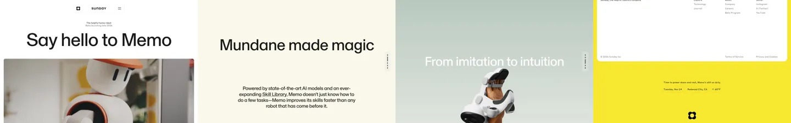
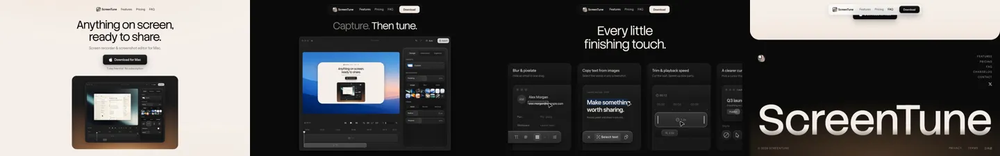
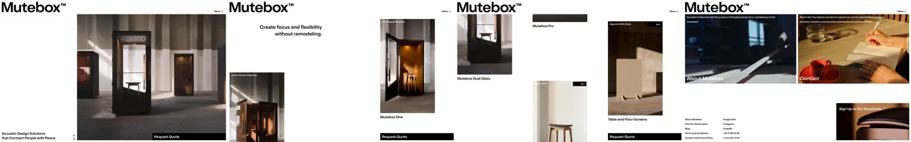
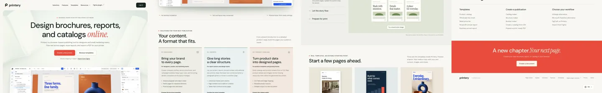
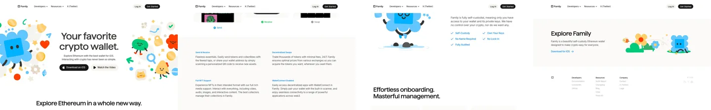
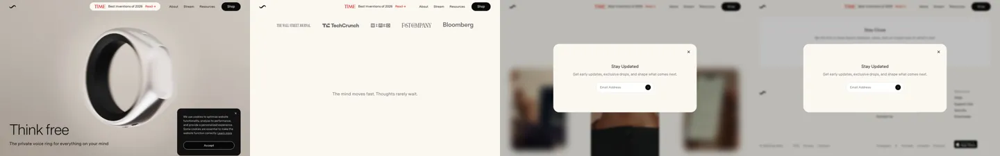

# Six product launches, seen in motion

I followed [Designeer’s Inspiration index](https://designeer.xyz/inspiration) to its [Minimal Gallery entry](https://designeer.xyz/inspiration/minimal-gallery), then opened the live sites from the gallery’s Product and App listings. The selection covers a physical object, a tool in use, and an interface that changes under your hand. The captures below show the live pages as seen on November 25, 2026.

## How to read the measurements

Each silent recording uses headless Chromium, a fresh browser context, a 1280 × 800 CSS viewport and a 960 × 600 recorded frame. The camera travels from top to bottom in eight stops, including 8%, 18%, 32%, 50%, 68% and 84% of the scroll range. The four stills per strip are the opening, 18%, 50% and end. Fonts and transition durations are computed CSS values sampled at those stops. A timed transition and a scroll-linked transformation measure different things. The latter is described by its travel or observable handoff. Cookie and newsletter overlays can appear in the captures.

The colour count measures broad areas of the first screen, including photography. I resampled to 128 × 80, grouped sRGB channels into steps of 32 and counted bins occupying at least 4% of the frame. Small accent colours can be visually important while falling below this threshold.

## Sunday

A 120 px greeting introduces the robot by name. A 14 px line gives its category, with the robot itself already entering the lower half of the screen. Six significant colour bins, chiefly white, ink and warm shades in the footage. Across 13,371 px of travel, the opening close-up yields to household tasks, then a quieter explanation of how the robot learns. Sticky chapters put the object under titles as large as 142 px. Short interface transitions measure 150–300 ms. The ending offers the beta program in the footer, followed by a full-width colour field and a local time-and-weather signoff. [Gallery](https://minimal.gallery/sunday/) · [Product](https://www.sunday.ai/) · [Scroll recording](../../docs/landing-review/references/sunday.mp4)

## ScreenTune

A 57.6 px promise, an 18 px Mac recorder/editor description and a download button precede the editor window. Three dominant bins. The pale opening changes to near-black while the editor stays at the centre. At 1,709 px the editor fills most of the stage. By 3,038 px the page has separated annotation and zoom into individual demonstrations. Secondary headings run from 46 to 64 px. Interface transitions range from 150 to 350 ms, with feature reveals of 900–1,000 ms. The final download panel repeats the trial terms and lifts to reveal the large wordmark. [Gallery](https://minimal.gallery/screentune/) · [Product](https://screentune.app/) · [Scroll recording](../../docs/landing-review/references/screentune.mp4)

## Mutebox

A wordmark sits above a single architectural image. The acoustic-design description is 20 px at the lower left, with a quote action along the image edge. Four dominant colour bins. The open space on the left of the first image becomes the space between later product portraits. Multiple sticky elements are present around the 18% and 50% samples. The brand and quote action remain recognisable while the booths and captions change scale. Common transitions are 300, 400 and 800 ms. A 100 px catalogue invitation hands off to showroom, contact and newsletter actions. [Gallery](https://minimal.gallery/mutebox/) · [Product](https://www.bymutebox.com/) · [Scroll recording](../../docs/landing-review/references/mutebox.mp4)

## Printery

A 67.84 px heading names the publications you can make. Its italic final word measures 74.62 px. One pale background bin dominates the image, with red reserved for the action and type accent. The editor crosses the first fold. Ordinary scrolling takes it past the viewer and introduces document types, shared styles, editable templates and a three-step workflow. None of the eight samples had a visible sticky element. The feature control illustrates a shared style change, with 200 ms transitions. Secondary headings sit around 42–43 px. The closing red band returns to creating a document. [Gallery](https://minimal.gallery/printery/) · [Product](https://www.printery.app/) · [Scroll recording](../../docs/landing-review/references/printery.mp4)

## Family

A centred 68 px heading names the wallet, framed on both sides by small characters. One white bin dominates. The small illustrations supply several saturated accents. Navigation is 15 px and chapter headings are 44 px. Download and video actions sit together on the first screen. Scrolling reveals transactions in product UI before alternating detail views with illustration and short text. The 10,515 px journey keeps a navigation element sticky, with a second sticky element in the later details chapter. Controls have 100–200 ms transitions and the first product section includes 1 s transitions. The illustrated closing panel returns to the iOS download. [Gallery](https://minimal.gallery/family/) · [Product](https://family.co/) · [Scroll recording](../../docs/landing-review/references/family.mp4)

## Sandbar

A 76 px headline sits low in the frame. The 22 px description identifies a private voice ring. The ring dominates the opening image, with seven major tonal bins. One viewport of movement takes the viewer from the object to press marks, then to a short piece of editorial text. A day-in-use film and feature details follow. The later dictation title returns to 76 px. No visible CSS sticky elements appeared in the sampled frames. Header transitions measure 450 ms, with 300–400 ms transitions later on. An independently timed newsletter overlay obscures part of the recording. The underlying close offers email updates and a shop link. [Gallery](https://minimal.gallery/sandbar/) · [Product](https://www.sandbar.com/) · [Scroll recording](../../docs/landing-review/references/sandbar.mp4)

## Decisions for Curb Cut

| Axis | Direction |
| --- | --- |
| Opening | Identify the Chrome extension and its audience beside a single large Tab key. Install and GitHub share the first screen. |
| Colour | Pale lilac field, deep plum type, vivid orange key and accents. Colour in the evidence belongs to the recorded site. |
| Scale | A large, closely set headline shares the frame with one object. Body text stays readable at ordinary reading size. Evidence captions use a small monospaced face. |
| Scroll and handoff | The key compresses as the reader approaches a real keyboard task. The next chapter cuts from an object you recognise to a menu you can test. Leave ordinary page scrolling in control. |
| Timing | Scroll determines the mechanical travel. The repair state has an immediate text change and a short visual transition. Reduced motion shows the settled artwork and switches evidence directly. |
| Product | The key is an illustration. The menu is an actual Mass.edu capture. Compare the two recorded states, try the keys and inspect the original Kane run. |
| Closing, after approval | Return from the individual browser repair to the site owner and developer workflow, then repeat the extension download with unpacked-install instructions. |

## Checkpoint

[Opening and repair beside the references](../../docs/landing-review/comparison.png) · [Colour and type](type-and-colour.md) · [Desktop scroll-through](../../docs/landing-review/desktop-scroll.mp4) · [Mobile scroll-through](../../docs/landing-review/mobile-scroll.mp4)

The desktop recording shows the switch compressing, the menu repair on scroll, a manual keyboard retry, and Kane reaching the destination. On mobile the visitor operates the repair switch. With reduced motion, the artwork stays still and the visitor chooses the repair state.

At 320, 390 and 1440 px, axe-core 4.10.3 reported zero violations and the document width matched the viewport. A keyboard check reached The DHE after switching on the repair at each width. A cold mobile Lighthouse 12.8.2 run scored 100 for accessibility and 93 for performance. The local and Pages builds each produced 105 repairs, including 61 Kane-verified and 44 with local proof. The repository evidence check validated 606 URLs and 229 videos.
