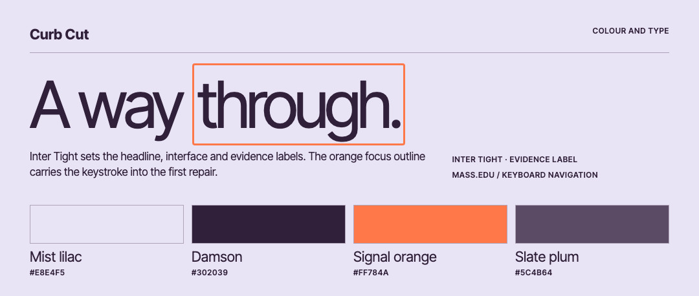

# Curb Cut colour and type

| Swatch | Use |
| --- | --- |
| Mist lilac · `#E8E4F5` | Opening field and light text on plum |
| Damson · `#302039` | Main type, line drawings and dark evidence chapter |
| Signal orange · `#FF784A` | Physical Tab key, travelling focus outline and active repair switch |
| Slate plum · `#5C4B64` | Supporting text on lilac |

Inter Tight sets the headline, body, controls and evidence labels. Display sizes range from 52 px on small screens to 132 px in the desktop chapters. The compact labels use weight and spacing to distinguish them from body text. The font and its licence ship with the site.

The orange outline moves from the key to the headline and lands on the About menu as the page scrolls. Reduced motion keeps the key still and leaves the menu entirely under the visitor’s control. Recorded websites and terminal sessions retain their own typography and colours.
