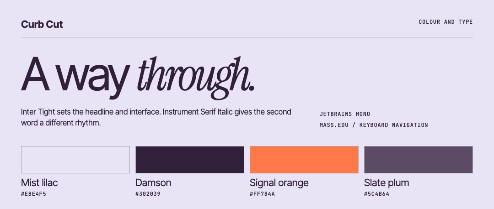

# Curb Cut colour and type

| Swatch | Use |
| --- | --- |
| Mist lilac · `#E8E4F5` | Opening field and light text on plum |
| Damson · `#302039` | Main type, line drawings and dark evidence chapter |
| Signal orange · `#FF784A` | Active repair switch, case title accent and physical Tab key |
| Slate plum · `#5C4B64` | Supporting text on lilac |

The display uses locally hosted Inter Tight with compact spacing and a single word in Instrument Serif Italic. The italic changes the pace of the headline and carries through to the case title. Interface and body copy use Inter Tight. JetBrains Mono identifies the capture source and the selected evidence state. Each family already ships with its licence in the repository.

The opening pairs a large, mechanical keyboard switch with generous space for the message. The second chapter uses the same orange for the active repair and reserves full-colour photography for the actual site capture.
